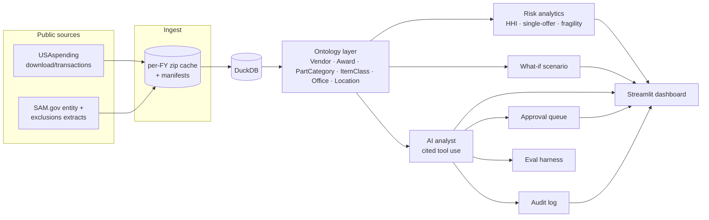

# Chokepoint

**A supply-chain risk workbench for the U.S. defense industrial base, built only on public federal contracting data.**

The Pentagon depends on thousands of small suppliers, and many part categories are effectively single-sourced. Nobody has an easy way to ask: *if this vendor disappeared tomorrow, what breaks, how much money is exposed, and who else has ever been awarded this work?* Chokepoint answers that for DoD purchases of electrical and electronic components (federal supply group 59, FY2019–FY2026). It models prime awards as an ontology, scores concentration and fragility risk, and adds an AI analyst whose every claim is cited and whose proposed actions need human approval.

> **Status: in development (milestone 2 of 7).** The scope and data schema are done, and the cached USAspending downloader is built and tested. Next: the DuckDB load and the object layer. Design rationale lives in [DECISIONS.md](DECISIONS.md); the data model is in [docs/ontology.md](docs/ontology.md).

## Architecture (planned)


## Quick start
```bash
pip install uv                                    # once
uv sync                                           # Python 3.12 venv + dependencies
cp .env.example .env                              # add keys; .env is gitignored
uv run python -m chokepoint.ingest.usaspending    # download FY2019–FY2026 (cached; ~10–20 min first run)
uv run pytest                                     # tests (no network needed)
```

## Repository layout
| Path | What |
|---|---|
| `chokepoint/config.py` | Data slice, fiscal-year window, verified column list |
| `chokepoint/ingest/` | USAspending downloader with cache (`usaspending.py`) and parsing rules (`parse.py`) |
| `notebooks/01_api_exploration.py` | Reproducible API exploration behind the scope decision |
| `docs/ontology.md` | Object types, properties, links, and why |
| `DECISIONS.md` | Every non-trivial design decision with alternatives |
| `tests/` | Unit tests; `fixtures/` holds 40 real public rows covering edge cases |

## Data limitations
Stated up front because they bound every conclusion:
- **Prime awards only.** Subcontract tiers are invisible.
- **Awardee ≠ manufacturer.** Many FSG 59 vendors are distributors, so "alternatives" means *past awardees*, not *qualified makers*.
- **DoD data is published with a 90-day delay** ([FPDS](https://www.fpds.gov/common/html/dodDataAvailability.html)). The most recent fiscal year is refreshed until it settles.
- **Vendor parent relationships are self-reported and sometimes wrong** (DECISIONS D-005).
- **Item classes** come from DLA item names truncated at 19 characters. They are finer than a product code (PSC) but are not part numbers.
- **PSC coding errors** in FPDS will misplace some awards.

## License
MIT. The data is U.S. government public data from [USAspending.gov](https://www.usaspending.gov) and [SAM.gov](https://sam.gov).
