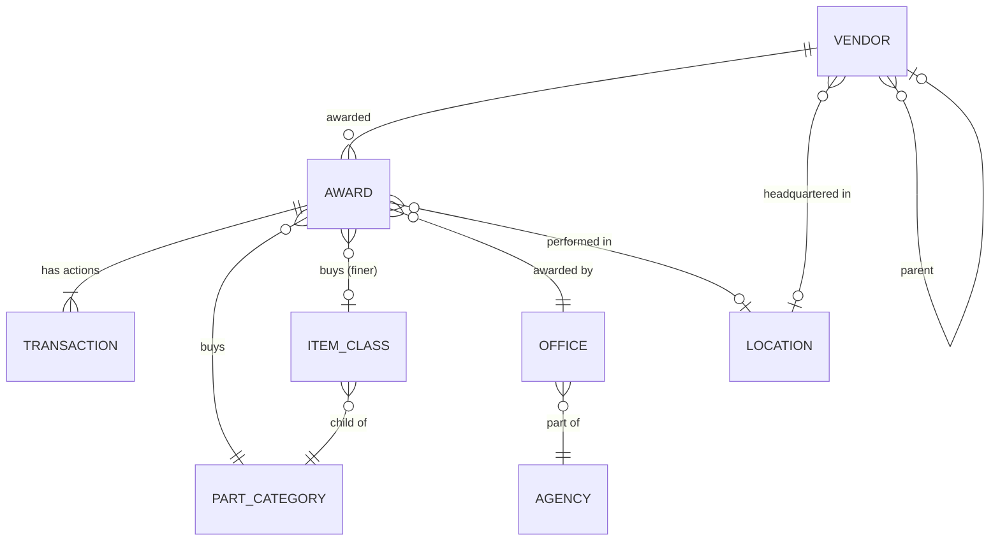

# Chokepoint ontology

**Status: DRAFT, awaiting sign-off (M1).** Every field below comes from a real USAspending `download/transactions` file (sample: FSG 59, DoD, 2025-09-01 to 2025-09-07, 1,231 rows, 297 columns). None are guessed from memory. The source column is listed for each property.

## Why an ontology and not just tables
Analysts don't think in rows; they think in *things* and *relationships*: "this vendor supplies these part types to these offices." Modeling objects and links explicitly lets us:
1. **Ask questions as traversals** ("vendor → awards → categories → other vendors in those categories" *is* the what-if scenario), and expose those same traversals as AI-agent tools. The agent then reasons over objects and never writes raw SQL.
2. **Give every fact an ID** an agent can cite and a test can verify. Citation checking (M6) only works because each object has a stable primary key.
3. **Keep data quality issues in one place.** Rules such as "which PSC does an award belong to when mods disagree" get decided once at the object layer, not re-decided in every query.

Storage is DuckDB tables; `chokepoint/ontology/` wraps them in typed pydantic objects with link-traversal methods.

## Object types

### Transaction (the raw fact; one row per contract action)
| Property | Type | Source column | Notes |
|---|---|---|---|
| `txn_key` **PK** | str | `contract_transaction_unique_key` | |
| `award_key` → Award | str | `contract_award_unique_key` | |
| `mod_number` | str | `modification_number` | `"0"` = base award |
| `action_date` | date | `action_date` | |
| `fiscal_year` | int | `action_date_fiscal_year` | |
| `obligation` | decimal | `federal_action_obligation` | **Can be ≤ 0** (23% of sample rows: de-obligations and admin mods). Always net; never filter. |
| `description` | str | `transaction_description` | |

Transactions aren't a "business object" an operator cares about, but every dollar figure is a sum of them. They are the ground truth for citation checks.

### Award
| Property | Type | Source | Notes |
|---|---|---|---|
| `award_key` **PK** | str | `contract_award_unique_key` | e.g. `CONT_AWD_SPE7M025P4435_9700_-NONE-_-NONE-` |
| `piid` | str | `award_id_piid` | Human-readable ID shown in the UI |
| `parent_piid` | str? | `parent_award_id_piid` | IDV the order was placed against |
| `vendor_uei` → Vendor | str | `recipient_uei` | |
| `psc_code` → PartCategory | str | `product_or_service_code` | Taken from the **earliest in-window transaction** (D-008) |
| `item_class_id` → ItemClass | str? | parsed from `transaction_description` | Null when not in `PR#!ITEM NAME` format (~15% of rows) |
| `office_code` → Office | str | `awarding_office_code` | |
| `naics_code` | str | `naics_code` | Kept as an attribute; not an object (D-009) |
| `award_type_code` | str | `award_type_code` | A/B/C/D |
| `extent_competed_code` | str | `extent_competed_code` | Mapped to competed / not competed / ambiguous (D-006) |
| `number_of_offers` | int? | `number_of_offers_received` | `1` = single-offer (D-007) |
| `pop_county_fips` → Location | str? | `prime_award_transaction_place_of_performance_county_fips_code` | |
| `obligated_in_window` | decimal | Σ Transaction.obligation | Derived |
| `first_action_date`, `last_action_date` | date | min/max of `action_date` | Derived |
| `permalink` | str | `usaspending_permalink` | Lets a human check any citation in one click |

### Vendor
| Property | Type | Source | Notes |
|---|---|---|---|
| `uei` **PK** | str | `recipient_uei` | |
| `name` | str | `recipient_name` | Latest name seen |
| `parent_uei` | str | `recipient_parent_uei` | Self-reported and sometimes wrong (D-005) |
| `parent_name` | str | `recipient_parent_name` | |
| `hq_county_fips` → Location | str? | `prime_award_transaction_recipient_county_fips_code` | |
| `business_size` | str | `contracting_officers_determination_of_business_size` | Latest value |
| `sam_status`, `sam_expiration_date` | str?, date? | SAM Entity API `registrationStatus`, `registrationExpirationDate` | Enrichment (M2) |
| `is_excluded`, `exclusion_type` | bool, str? | SAM Exclusions API `ueiSAM`, `exclusionType` | Enrichment (M2) |
| `dod_share_of_federal` | float? | USAspending recipient endpoint | Top ~300 vendors only; the proxy for "DoD-dependent" (we cannot see revenue) |

### PartCategory (PSC)
| Property | Type | Source |
|---|---|---|
| `psc_code` **PK** | str | `product_or_service_code` (e.g. `5962`) |
| `description` | str | `product_or_service_code_description` |
| `fsg` | str | first two characters (`59`) |

### ItemClass (sub-PSC; this is the interesting one)
| Property | Type | Source |
|---|---|---|
| `item_class_id` **PK** | str | `"{psc_code}:{item_name}"` |
| `psc_code` → PartCategory | str | |
| `item_name` | str | text after `!` in DLA descriptions, e.g. `MICROCIRCUIT,HYBRID`, `CIRCUIT CARD ASSEMB` |

**Why it exists:** a 4-digit PSC such as 5962 "Microcircuits" has hundreds of awardees, so its HHI looks healthy, yet individual item types inside it can be single-source. DLA truncates item names at a **fixed 19 characters**, so the truncated string is still a stable grouping key. It is not an NSN; different NSNs share an item name. ItemClass is "finer than PSC, coarser than part number," and the docs must say so.

### Agency / Office
| Object | PK | Properties | Source |
|---|---|---|---|
| Agency | `agency_code` (`97AS`) | `name` | `awarding_sub_agency_code`, `awarding_sub_agency_name` |
| Office | `office_code` (`SPE7M1`) | `name`, `agency_code` → Agency | `awarding_office_code`, `awarding_office_name` |

### Location (county)
| Property | Type | Source |
|---|---|---|
| `county_fips` **PK** | str (5-digit) | `..._county_fips_code` |
| `state_code`, `county_name` | str | `primary_place_of_performance_state_code`, `primary_place_of_performance_county_name` |

## Links

## Derived views (analytics layer, M3; not stored objects)
- `category_vendor_share`: dollars per (PSC or ItemClass, vendor-or-parent, FY window), the input to HHI and top-share.
- `vendor_exposure`: per vendor, the categories it touches and its share of each. This is the what-if scenario.

## Known modeling compromises
- **Prime awards only.** A sub-tier chip maker behind a distributor is invisible.
- **Vendor ≠ manufacturer.** Many FSG 59 awardees are distributors or aftermarket sources. Alternatives are labeled *past awardees*, not *capable manufacturers*.
- **Window edge effects.** Awards whose base action predates FY2019 appear only through their in-window modifications.
